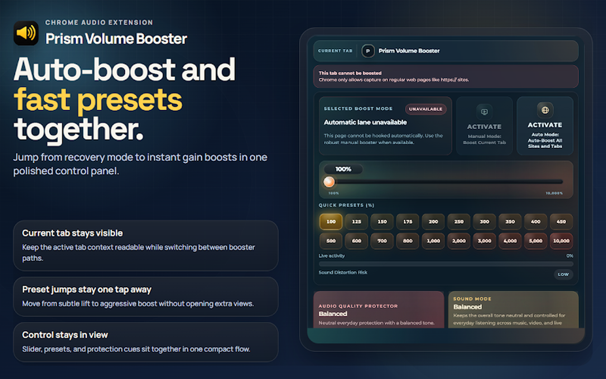

<div align="center">

# Volume Booster

**Make any tab louder — with the audio processed locally, never uploaded.**

A Chrome (Manifest V3) volume booster with a local Faust DSP chain, per-tab capture and an optional all-sites auto-boost lane. MIT-licensed, fully buildable from source.

[](./LICENSE)
[](./public/manifest.json)
[](https://developer.chrome.com/docs/extensions/reference/api)
[](https://nodejs.org/)
[](https://www.typescriptlang.org/)
[](./docs/i18n/README.md)
[](https://github.com/LisandroNahuelH/volume-booster/releases)
[](https://chromewebstore.google.com/detail/kahflpfpncmoabkjpoppgbiihjgpiejc)



</div>

---

## What it is

Volume Booster raises the volume of what you are listening to in Chrome — beyond what the page itself allows — without routing your audio through any server. It captures the active tab (only after you ask for it), processes the stream in a local audio graph, and plays it back amplified.

| Feature | What it does |
|---|---|
| Manual boost | Boosts the current tab on demand from the popup; the capture starts from your click. |
| Auto-boost (All Sites) | Optional lane that attaches to pages automatically and applies your saved profile. |
| Per-site settings | Remembers settings per domain so a site opens with the boost you chose. |
| Premium profile | Signed license verified offline (Ed25519) with a 30-day trial; unlocks advanced audio controls. |
| Localized UI | English and Spanish catalogs through Chrome's `_locales` pipeline with strict key parity. |
| Local by design | Audio is processed on your machine; the only network calls are the anonymous heartbeat and optional error diagnostics. |

Published on the Chrome Web Store as [Volume Booster Premium11](https://chromewebstore.google.com/detail/kahflpfpncmoabkjpoppgbiihjgpiejc).

## How it works

```
 popup ──user gesture──▶ service worker ──getMediaStreamId──▶ offscreen document
   │                          │                                    │
   │                          │ chrome.scripting                   │ WebAudio graph
   │                          ▼ .registerContentScripts()           ▼ AudioWorklet
   │                    content scripts (IIFE)                  Faust WASM DSP
   │                    auto-booster main + isolated         (mono/stereo, built
   │                    (All Sites lane only)                 from faust/*.dsp)
   └─ settings, presets, premium license (verified offline with the embedded public key)
```

- The service worker is the only durable coordinator: it owns capture, content-script registration and tab state.
- All audio lives in a single offscreen document: a WebAudio chain fed by a Faust WASM worklet compiled at build time from `faust/*.dsp`.
- The All Sites lane registers two small IIFE bundles at runtime; their contract is documented in [docs/agent-guardrails/all-sites-main-world-contract.md](docs/agent-guardrails/all-sites-main-world-contract.md).
- The premium license is a signed token verified locally against an embedded Ed25519 public key. The signing tooling is not part of this repository.

## Repository pieces

| Path | What it is |
|---|---|
| `src/background` | Service worker entry: capture, commands, lifecycle |
| `src/worker` | Orchestrator, auto-frame registry, per-tab aggregates, offscreen client |
| `src/offscreen` | Audio session and Faust worklet host |
| `src/content` | Content scripts: controller, media-element sessions, main-world bridge |
| `src/popup` | Extension popup UI |
| `src/shared` | Storage, settings, premium license verification, observability, runtime i18n |
| `src/features/heartbeat` | Anonymous install/update/ping diagnostics |
| `scripts` | Build, i18n and e2e tooling |
| `public/_locales` | Locale catalogs (EN, ES) |
| `faust/*.dsp` | DSP sources compiled to WASM at build time |
| `docs` | Architecture, limits, troubleshooting, i18n docs |

## Quick start

### Manual path

1. `git clone https://github.com/LisandroNahuelH/volume-booster.git && cd volume-booster`
2. `npm ci`
3. `npm run build`
4. Open `chrome://extensions`, enable **Developer mode**, click **Load unpacked**, and select the `dist/` folder (not the repository root).

`npm run verify` runs the full pipeline that CI runs.

### One prompt (for agents)

> You are an agent inside a clone of the volume-booster repository. Run `npm ci`, then `npm run verify`, then `npm run build`. Confirm `dist/manifest.json` exists and its version matches `package.json`. Then tell the user to open `chrome://extensions`, enable Developer mode, click **Load unpacked**, and select the `dist/` folder. Do not publish to the Chrome Web Store. Report the exact commands and raw output.

## Requirements

- Chrome or Chromium 116+ (desktop).
- Node.js 24+ and npm 10+ to build from source.
- No account, API keys, or external services are required to build or run from source.

## Security & trust

- Audio never leaves the machine: capture, DSP and playback happen locally in the extension's offscreen document.
- No remote code: the extension ships compiled WASM and runs under `script-src 'self' 'wasm-unsafe-eval'`.
- Permissions are declared up front: `tabCapture` starts only from your click, `<all_urls>` powers the optional All Sites lane, and `offscreen`, `alarms`, `scripting`, `storage`, `tabs` and `activeTab` support the features above.
- Anonymous heartbeat: on install/update, and at most once per 24 h, the extension sends a small payload (version, event, random install id, locale, timezone) to `https://www.premium11.com/api/heartbeat`. No URLs, tab ids, page content, or audio. Details and how to remove it from your own build: [SECURITY.md → Privacy](SECURITY.md#privacy).
- Error diagnostics (Sentry) are compiled in only when a build provides a DSN — source builds have none by default — and the scrubber removes URLs, titles and request data.

Inspect the claims yourself:

```bash
npm ci && npm run verify                       # full local pipeline (same as CI)
grep -rn "fetch(" src/background src/worker src/offscreen src/features   # every outbound call in the runtime
```

## Limits (honest ones)

- DRM/EME-protected players and `chrome://` pages cannot be captured or boosted.
- Boost amplifies the signal that exists; it cannot recover audio that is muted or absent at the source.
- The All Sites lane depends on site compatibility (frameworks, CSP, iframes); some pages need a reload.
- Desktop Chromium only — no Firefox, no Safari.

Full list: [docs/limits.md](docs/limits.md).

## Uninstall

1. Open `chrome://extensions` and remove the extension (or use **Remove from Chrome** on the store listing).
2. That's it: Chrome clears the extension's local storage on uninstall. The goodbye page opens once, recording the uninstall (anonymous id and version only).

## Documentation

| Doc | For |
|---|---|
| [AGENTS.md](AGENTS.md) | the installing agent — runbook + verification |
| [docs/architecture.md](docs/architecture.md) | how the runtime works |
| [docs/limits.md](docs/limits.md) | what is guaranteed, and the edges |
| [docs/troubleshooting.md](docs/troubleshooting.md) | build failures, logs, recovery |
| [docs/i18n/README.md](docs/i18n/README.md) | the localization pipeline |
| [SECURITY.md](SECURITY.md) | privacy and vulnerability reporting |
| [THIRD_PARTY-LICENSES.md](THIRD_PARTY-LICENSES.md) | third-party licenses |

## FAQ

<details><summary>Does my audio get uploaded anywhere?</summary>

No. Capture, DSP and playback are local to your browser. The only network traffic is the anonymous heartbeat and, in builds that opt in with a DSN, scrubbed error reports.
</details>

<details><summary>Do I need an account?</summary>

No. Premium is activated with a signed license key that is verified offline against a public key embedded in the extension. There is a 30-day trial.
</details>

<details><summary>Why does it ask to read and change data on all sites?</summary>

Only the optional All Sites auto-boost lane needs it. Manual boost works from your click via `activeTab`; if you never enable All Sites, that permission stays unused.
</details>

<details><summary>Can I build my own copy?</summary>

Yes — the code is MIT-licensed and `npm run verify` reproduces what CI runs. Forks are welcome under a different name and extension ID; the Premium11 name, logo and store listings are not covered by the MIT grant.
</details>

<details><summary>Does it work in Firefox or Safari?</summary>

No. This is a Manifest V3 extension for Chromium browsers (Chrome, Edge, Brave, …), Chrome 116+.
</details>

<details><summary>Some sites barely change volume — why?</summary>

Protected players (DRM), `chrome://` pages and some embedded players cannot be captured or boosted. See [docs/limits.md](docs/limits.md).
</details>

## Credits

Built by [@LisandroNahuelH](https://github.com/LisandroNahuelH) · Premium11. DSP powered by [Faust](https://faust.grame.fr/) (GRAME). MIT licensed — the Premium11 name, logo and store listings are not covered by the license grant. The premium license signing tooling is intentionally not part of this repository.
